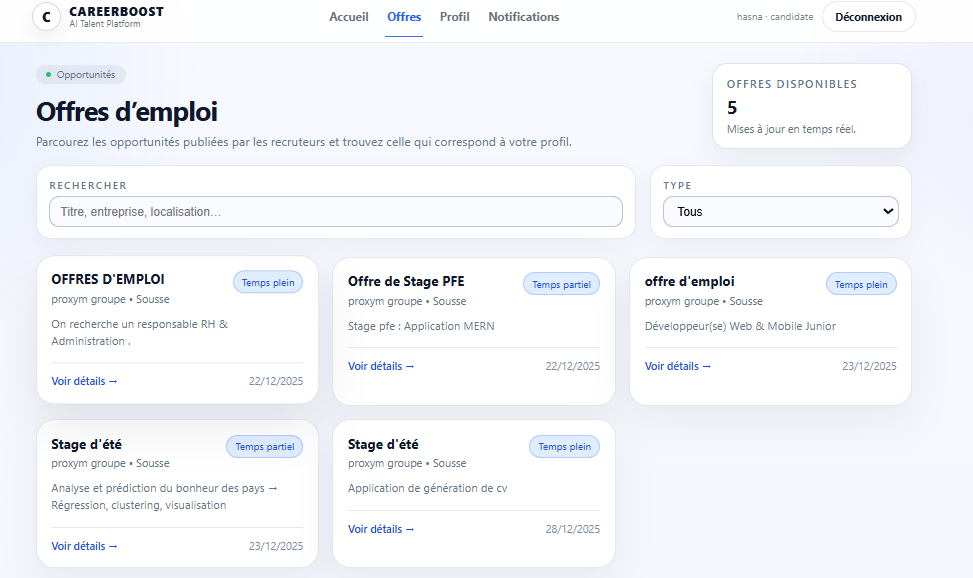
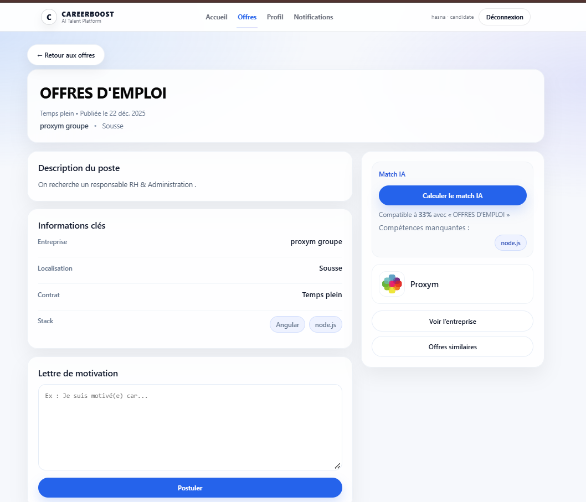
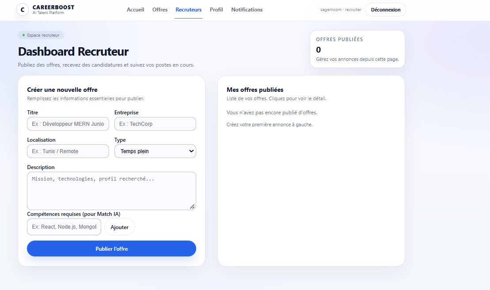
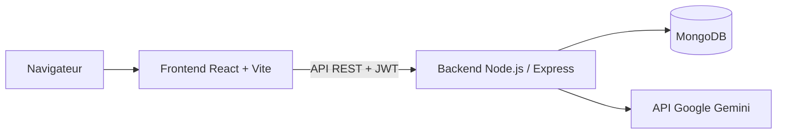

# CareerBoost AI – Plateforme de recrutement avec matching de compétences et IA générative

CareerBoost AI est une application web qui met en relation **candidats** et **recruteurs**. Les candidats construisent leur profil, génèrent une bio professionnelle avec l'IA (Gemini), consultent les offres, mesurent leur compatibilité avec chaque poste et postulent. Les recruteurs publient des offres, gèrent la page de leur entreprise et suivent les candidatures reçues.

Le projet repose sur la stack **MERN** (MongoDB, Express, React, Node.js) avec une API REST sécurisée par **JWT**.

<p align="center">
  
</p>

---

## Fonctionnalités

### Authentification et rôles
- Inscription et connexion avec mot de passe chiffré (bcrypt) et jeton JWT.
- deux rôles : **candidat**, **recruteur**.

### Espace candidat
- **Profil professionnel** : nom, titre, localisation, années d'expérience, objectifs, liens LinkedIn et portfolio, compétences (nettoyées, sans doublons, 30 au maximum).
- **Génération de bio par IA** : Gemini rédige une bio professionnelle de 3 à 5 phrases, prête à publier sur LinkedIn, à partir du profil.
- **Consultation des offres** avec recherche et filtre par type de contrat.
- **Score de compatibilité** avec chaque offre, avec la liste des compétences acquises, des compétences manquantes et des compétences recommandées.
- **Candidature** avec lettre de motivation, suivi de ses candidatures et possibilité de les retirer.

### Espace recruteur
- **Tableau de bord** pour créer, modifier et supprimer ses offres (titre, entreprise, localisation, type de contrat, description, compétences requises, salaire).
- **Page entreprise** publique : logo, image de couverture, description, secteur, taille, site web, LinkedIn et album de 3 photos.
- **Gestion des candidatures** reçues pour chaque offre, avec changement de statut : en attente, examinée, acceptée ou refusée.

### Notifications
- Le recruteur est notifié à chaque nouvelle candidature.
- Le candidat est notifié quand le statut de sa candidature change.
- Compteur de notifications non lues, lecture individuelle ou globale.

---

## Captures d'écran

<p align="center">
  
  
</p>

<p align="center">
  
</p>

---

## Fonctionnement de l'IA et du matching

### Génération de bio avec Gemini
Le backend envoie à Gemini un prompt structuré contenant le profil du candidat, avec des contraintes de style (première personne, ton professionnel, 3 à 5 phrases, sans hashtags ni titres).

Pour garantir la disponibilité du service :
- le backend essaie **plusieurs modèles Gemini** successivement jusqu'à obtenir une réponse ;
- si le quota de l'API est dépassé, une **bio de secours** est générée localement à partir du profil.

### Score de compatibilité
Les compétences du profil et celles de l'offre sont normalisées (minuscules, espaces nettoyés), puis comparées avec l'**indice de Jaccard** :

```
score = compétences communes / ensemble des compétences du profil et de l'offre
```

La réponse contient le pourcentage de compatibilité, les compétences en commun, les compétences manquantes et les cinq premières compétences recommandées.

---

## Architecture



Le backend suit une organisation en couches :

| Dossier | Rôle |
| --- | --- |
| `config/` | Connexion à MongoDB et configuration de Gemini |
| `models/` | Schémas Mongoose (utilisateur, profil, offre, candidature, notification, entreprise, compétence) |
| `controllers/` | Logique métier de chaque ressource |
| `routes/` | Définition des points d'entrée de l'API |
| `middleware/` | Authentification JWT et gestion des erreurs |
| `utils/` | Fonctions utilitaires |

---

## Technologies

| Domaine | Outils |
| --- | --- |
| Frontend | React, Vite, React Router, Axios, Context API |
| Backend | Node.js, Express, express-async-handler, Multer |
| Base de données | MongoDB, Mongoose |
| Sécurité | JWT, bcrypt |
| IA | API Google Gemini |

---

## API

| Ressource | Route | Principales actions |
| --- | --- | --- |
| Authentification | `/api/auth` | Inscription, connexion, utilisateur connecté |
| Profils | `/api/profiles` | Créer, consulter, modifier, supprimer son profil |
| Offres | `/api/jobs` | Lister, consulter, créer, modifier, supprimer |
| Candidatures | `/api/applications` | Postuler, mes candidatures, candidatures d'une offre, statut |
| Notifications | `/api/notifications` | Liste, non lues, marquer comme lu |
| Entreprises | `/api/company-profiles` | Page entreprise publique et gestion par le recruteur |
| Compétences | `/api/skills` | Catalogue de compétences |

La génération de bio et le calcul du score de compatibilité disposent de leurs propres routes, définies dans `backend/routes/`.

---

## Lancer le projet en local

### Prérequis
- Node.js 18 ou plus
- Une base MongoDB (locale ou MongoDB Atlas)
- Une clé API Gemini ([Google AI Studio](https://aistudio.google.com/))

### Backend

```bash
cd backend
cp .env.example .env
npm install
npm run dev
```

Variables du fichier `backend/.env` :

| Variable | Description |
| --- | --- |
| `PORT` | Port du serveur (5000 par défaut) |
| `MONGO_URI` | Adresse de la base MongoDB |
| `JWT_SECRET` | Clé de signature des jetons |
| `JWT_EXPIRES_IN` | Durée de validité des jetons (7d par défaut) |
| `GEMINI_API_KEY` | Clé de l'API Gemini |

### Frontend

```bash
cd frontend
cp .env.example .env
npm install
npm run dev
```

L'application est disponible sur http://localhost:5173 et l'API sur http://localhost:5000/api.

---

## Structure du projet

```
careerboost-ai/
├── backend/
│   ├── config/
│   ├── controllers/
│   ├── middleware/
│   ├── models/
│   ├── routes/
│   └── utils/
├── frontend/
│   └── src/
│       ├── api/
│       ├── components/
│       ├── context/
│       └── pages/
└── docs/
    └── screenshots/
```

---

## Auteure

**Ines Elouaer** – Ingénieure IA / Machine Learning
[LinkedIn](https://linkedin.com/in/ines-elouaer) · [GitHub](https://github.com/ines-elouaer)
